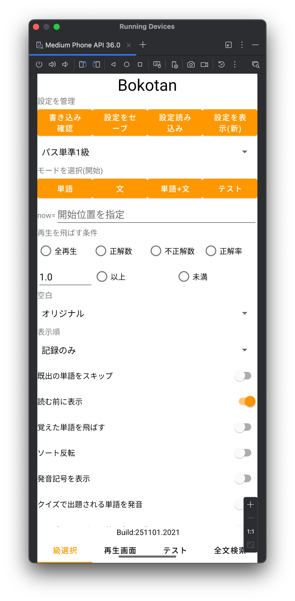
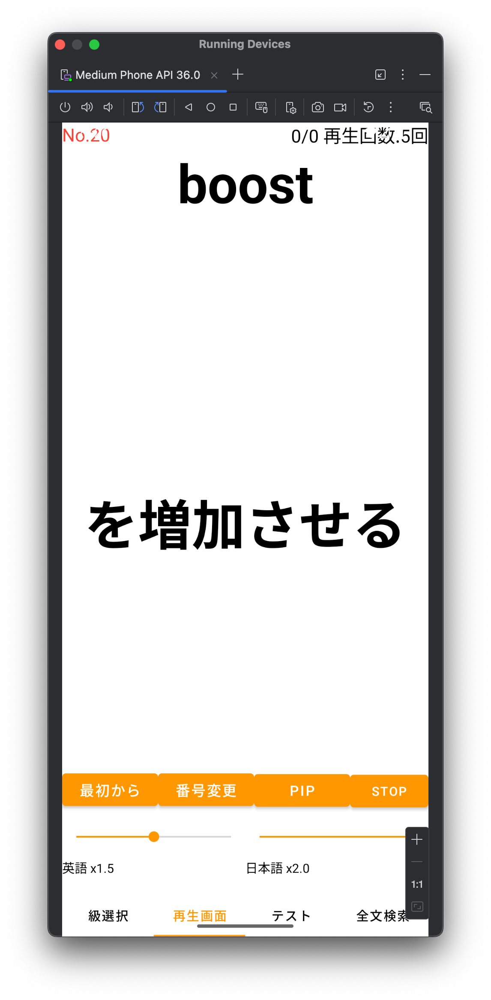
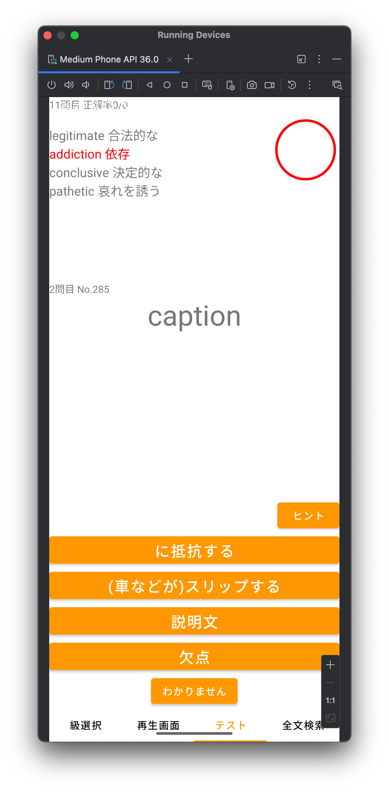
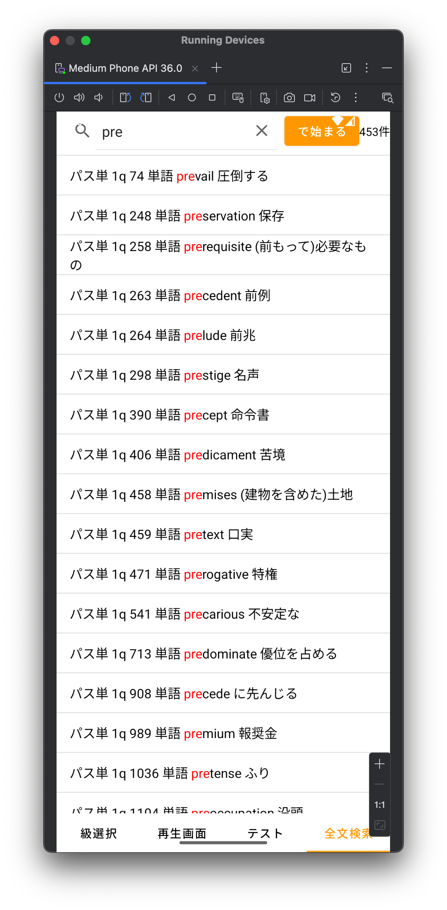

# Bokotan

Androidで動く英単語学習アプリです。

[プライバシーポリシー](https://kmr-gks.github.io/Bokotan/privacy-policy.html)はGitHub Pagesで公開しています。
公開元と更新方法は[プライバシーポリシーの公開手順](docs/privacy-policy-pages.txt)を参照してください。

家から大学まで通うときに電車の中で英語音源を流して英単語を覚えたいという思いで開発しました。

単語データは単語帳を購入して、手打ち入力しています。音声データは出版社のサイトからダウンロードすることができます。

英語の音声はダウンロードできますが、日本語の音声はない場合があります。その時は、VOICEBOXを利用して作成しました。

# 注意

出版社由来の音声・単語データは含めていません。動作確認用のフリーな5語と英日音声はアプリに同梱しています。

従来の書籍の音声ファイルはスマホの内蔵ストレージのダウンロードフォルダ(/storage/emulated/0/Download/data)にあることを想定しています。

従来の書籍のデータファイルはapp/src/main/assetsにあることを想定しています。サンプルは追加操作なく使えます。

# アプリの特徴

* パス単、ユメタン、単熟語EXに対応しています。
* 単語の日本語訳、英訳を確認しながら発音を確認できます。
* テストモードでは、英単語が表示されるので日本語訳4択から一つ選んで答えます。
* 検索モードでは、全単語とその訳から一括検索できます。



起動時の画面




再生画面




テストの画面




検索画面


# ビルドする方法

クローンしたフォルダをAndroid Studioで開きます(画像はWindows 10で開いた場合です)。


このままではビルドできないので、Add Configuration...をクリックします。このようなウィンドウが表示されます。


左上の+をクリックし、Android Appを選択します。


NameをAppにし、ModuleをBokotan.app.mainに設定します。


OKを押してウィンドウを閉じます。これで、ビルドができるようになります。

# その他

## JDKのエラーが出たとき

メニュー>File>Settings>Build, Execution, Deployment>Buid Tools>Gradle

からJDKパスの設定画面を開く。Gradle JDKのパスを

C:\Program Files\Android\Android Studio\jbr

にする。

## エラーが英語のとき

メニュー＞Help＞Edit Custom VM Options...を選ぶ
-Dfile.encoding=UTF-8
を追加する


## バージョン1.05と同梱サンプル

1.05ではAndroid標準のファイル選択から個人データのZIPを取り込めます。
更新内容と検証範囲は[更新記録](docs/release-1.05.txt)を参照してください。

5語と英日10音声はアプリに同梱しています。起動画面で「サンプル」を選ぶと、
追加のファイル配置やストレージ権限なしで再生・検索・クイズができます。
[サンプルの説明](samples/free-vocabulary/README.txt)も参照してください。ビルドはJDK 17で実行します。

```sh
bash gradlew assembleDebug
```

## GitHub ActionsのAPK・AAB

push、pull request、手動実行でテスト・Lint・ビルドを行います。
GitHubのActionsから実行結果を開くと、Artifactsから次をダウンロードできます。

- `bokotan-バージョン-debug-sample`：インストール可能なdebug APK、debug AAB、サンプル音声とライセンス。
- `bokotan-バージョン-release-unsigned`：同梱サンプル付きの未署名release APKとAAB。正式な配布には署名が必要です。
- `reports-実行ID-試行番号`：テスト・Lintのレポート。

debug/releaseをローカルで生成する場合:

```sh
bash gradlew testDebugUnitTest lintDebug assembleDebug bundleDebug assembleRelease bundleRelease
```

バージョンは[version.properties](version.properties)で管理します。
まとまった更新時に`VERSION_CODE`を増やし、`VERSION_NAME`を更新します。


## 署名付きGitHub Release

[署名設定と公開手順](docs/signed-release.txt)に記載した4つのRepository Secretsを登録します。
バージョンに一致する`v1.03`などのタグをpushすると、`Signed Release`が署名を検証し、
GitHub ReleasesにAPK・AAB・チェックサムを公開します。

## 個人データをZIPから取り込む（1.05以降）

起動画面の「個人データをZIPから取り込む」→「ZIPを選択」からファイルを選びます。
Android標準のファイル選択画面を使用するため、全ファイルアクセス権限は不要です。
端末内のZIPに加え、ファイル選択画面に対応するGoogle Drive／OneDrive等の
クラウドアプリにログインしていれば、そのアプリが提供するZIPを選択できます。
クラウド側からの読み込みには通信が発生します。共有URLやクラウドの鍵は不要です。

取り込み中は展開済みMBを表示し、通知と画面から中止できます。画面回転・
アプリを背面に移動してもサービスで継続します。OSによるプロセス終了や
クラウド切断後の自動再開には対応していません。その場合は再度ZIPを選択します。
取得完了後は内部領域だけで動作し、オフラインで検索・再生・クイズができます。
取り込み成功後は「個人データ」が選択されます。サンプルは引き続き利用できます。

### ZIPの形式（format=1）

ZIPの直下に次の3項目を置きます。親フォルダごと圧縮しないでください。
一つのZIPが一つの単語セットです。複数の書籍をまとめる場合は単語番号を重複させず、
音声パスを別フォルダに分けてください。現在の形式は単語用で、例文・混合再生は対象外です。

```text
my-data.zip
├── package.properties
├── words.tsv
└── audio/
    ├── 1q/
    │   ├── 0001英.btv
    │   └── 0001訳.btv
    └── ...
```

`package.properties`はUTF-8のテキストです。

```properties
format=1
id=my-book
```

`id`は半角英数字・ハイフン・アンダースコアで1～64文字。
同じ単語セットを更新するときは同じidと単語番号を維持すると成績を引き継ぎます。
内容が違うセットには別のidを使います。書籍名や秘密のURLを入れる必要はありません。

`words.tsv`はUTF-8（BOMなし）のタブ区切りテキストで、先頭行は以下の5列を
**この順序・綴りで**指定してください。以下の列の間は実際のタブ文字です。

```tsv
id	english	japanese	english_audio	japanese_audio
1	dog	犬	audio/1q/0001英.btv	audio/1q/0001訳.btv
2	cat	猫	audio/1q/0002英.btv	audio/1q/0002訳.btv
```

- `id`: 0～100000の整数。飛び番可、重複不可。音声の元番号をそのまま使えます。
- `english`／`japanese`: 空欄不可。タブや改行を含めないでください。引用符によるエスケープはしません。
- 音声列: ZIP直下からの相対パス。必ず`audio/`で始め、区切りは`/`。
  元の日本語ファイル名やサブフォルダを維持できます。ファイル名の文字コードもUTF-8です。
- 両言語の音声が必要です。拡張子は`.mp3`／`.ogg`／`.wav`／`.m4a`／`.btv`。
  `.btv`は従来の音声名で、内容はAndroidが再生できる音声形式である必要があります。
  同じ音声を複数の行から参照することは可能です。
- 単語は1語以上。4択クイズには異なる日本語訳の単語が4語以上必要です。
- パスの`..`、絶対パス、重複ファイル、暗号化ZIPは使用しないでください。
- 展開サイズは最大8GiB、ファイル・フォルダ数は最大100000、各テキストは最大16MiB。
  1GB程度のZIPも、全体をメモリに載せず直接展開します。

Mac/Linuxでの作成例（`my-data`の中に上記の3項目を準備）：

```sh
cd /path/to/my-data
zip -r ../my-data.zip package.properties words.tsv audio
```

新しいZIPはセット全体を置き換えます。追記ではありません。形式と音声の存在を
検証してから切り替え、失敗・中止した場合は従来の個人データを維持します。
音声が再生可能かどうかは取り込み後の再生で確認してください。
空き容量は「新しい展開データ＋既存の個人データ＋余裕」が必要です。
端末に元ZIPも保存する場合は、その容量も別途必要です。

データはアプリのバックアップ対象外の内部領域に保存し、アプリから外部へ送信しません。
クラウドに置いたZIPの管理は利用者側で行ってください。アプリのアンインストール／
ストレージ消去で取り込んだデータは削除されるため、元ZIPは自分で保管してください。
本物のデータやZIPはこのリポジトリ・GitHub・AIに渡さないでください。
ビルド対象のassetsは公開サンプルのディレクトリだけに限定しています。
従来のapp/src/main/assetsへ置いたローカルデータはAPK/AABへ同梱しません。

公開サンプルだけで作った[取り込み例ZIP](samples/free-vocabulary/import-example.zip)を用意しています。
出典・ライセンスはZIP内の`audio/sample-notices/`に含まれます。
`python3 scripts/create_import_example.py`で再生成できます。

### 設定の保存・復元

全ファイルアクセス権限を削除したため、設定の保存先・復元元も標準のファイル選択で
指定する一つのJSONファイル（format=1）に変更しました。単語本文・音声・ZIPの参照元は
含みません。以前のDownload/bokotan内の分割txtバックアップとは形式が異なります。
